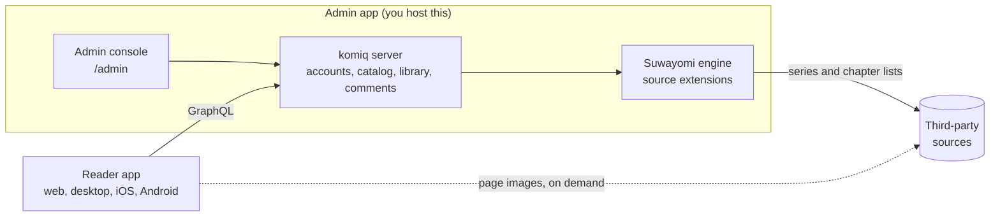

# komiq

**A self-hostable, open-source reader for manga and comics.** 
One codebase for the web, desktop, iOS and Android.

[Docs](https://docs.komiq.cc) · [Try the demo](https://komiq.cc) ·
[Host a server](https://docs.komiq.cc/self-host) ·
[Developers](https://docs.komiq.cc/developers)

## What komiq is

Komiq gives you one place to browse, read and organize manga and comics from the sources you
add. You host it yourself. It has two apps:

| App            | What it does                                                                                                                                   |
| -------------- | ---------------------------------------------------------------------------------------------------------------------------------------------- |
| **Admin app**  | The server and its management console in one. You run it on your computer with the desktop app, or with Docker on a home server or a VPS.      |
| **Reader app** | What you read with. It runs in a browser, on desktop, on iOS and on Android. It connects to a komiq server on your network or on the internet. |

With the reader app you can:

- search and browse a catalog of series,
- read chapters in a paged or long-strip reader,
- keep a personal library and your reading progress,
- write reviews and comment on chapters.

Komiq is reading software. It is not a publisher or a content service, and it does not come
with content. You add your own sources.

[`komiq.cc`](https://komiq.cc) is the project's free, work-in-progress demo. You read on it in a
browser. For now, the desktop and mobile apps connect to self-hosted servers only.

## How it works

1. **You run the admin app.** It starts the komiq server and the source engine. The engine is
   [Suwayomi-Server](https://github.com/Suwayomi/Suwayomi-Server), which talks to sources through
   extensions.
2. **You add sources in the admin console.** The server builds a catalog from them: series,
   authors, tags and chapter lists. It merges the same series from different sources into one
   entry.
3. **You connect the reader app to your server.** The app takes an IP address and port, a domain
   or a pasted link. A phone can also scan a QR code. The app asks the server for data over
   GraphQL.
4. **You open a chapter.** The pages are fetched from the source at that moment. A browser
   usually gets them through an image proxy. The desktop and mobile apps can fetch them directly.

The self-host server keeps accounts, libraries, reviews, comments and the catalog in PostgreSQL. It keeps
small cover thumbnails. It does not keep a permanent archive of chapter pages.

Read more: [What komiq is](https://docs.komiq.cc/start/what-is-komiq) ·
[How it works](https://docs.komiq.cc/start/how-it-works)

## Get started

| You want to                             | Go to                                                                                                        |
| --------------------------------------- | ------------------------------------------------------------------------------------------------------------ |
| Try komiq in a browser                  | [komiq.cc](https://komiq.cc)                                                                                 |
| Pick the setup that suits you           | [Choose your setup](https://docs.komiq.cc/start/choose-your-setup)                                           |
| Host a server on your computer          | [Run the desktop app](https://docs.komiq.cc/self-host/desktop-app)                                           |
| Host a server on a home server or a VPS | [Install with Docker](https://docs.komiq.cc/self-host/docker)                                                |
| Read on your own server                 | [Get the reader app](https://docs.komiq.cc/guide/apps) and [connect it](https://docs.komiq.cc/guide/connect) |

A fresh install opens the setup screens in the browser. The Docker steps are also in this
repository: [`docs/self-host.md`](./docs/self-host.md).

## Developers

All developer documentation lives at **[docs.komiq.cc/developers](https://docs.komiq.cc/developers)**.
Start there, not here.

| Page                                                                 | What it covers                            |
| -------------------------------------------------------------------- | ----------------------------------------- |
| [Architecture](https://docs.komiq.cc/developers/architecture)        | The parts of komiq and how they talk      |
| [Repository layout](https://docs.komiq.cc/developers/repository)     | Where each app and package lives          |
| [Run it locally](https://docs.komiq.cc/developers/local-development) | Tools, install steps and the dev commands |
| [Testing](https://docs.komiq.cc/developers/testing)                  | How to check your change                  |
| [Contributing](https://docs.komiq.cc/developers/contributing)        | How to send a change                      |

The repository in one look:

| Path             | What                                                             |
| ---------------- | ---------------------------------------------------------------- |
| `apps/reader`    | The reader app (SvelteKit, with a Tauri shell for native builds) |
| `apps/admin`     | The admin console and the desktop app that starts the server     |
| `apps/server`    | The komiq server (Rust, GraphQL, PostgreSQL; SQLite covers)       |
| `apps/worker`    | The optional image proxy (Cloudflare Worker)                     |
| `apps/docs`      | The docs site, docs.komiq.cc                                     |
| `packages/api`   | The data layer the apps share                                    |
| `packages/types` | Shared domain types                                              |
| `packages/ui`    | Design tokens and shared components                              |

## How content is handled

- Eligible community members can add third-party sources. A source added through
  that process becomes available globally without the Komiq operator selecting it
  individually.
- Covers and pages are retrieved on demand when someone uses the reader. The web
  path may proxy image responses through Cloudflare and temporarily store them in
  Cloudflare's edge cache. Native builds may fetch directly from a source or through
  the app's local Suwayomi engine.
- Komiq is not intended to operate a permanent central archive of manga or comic
  image files. Copies can still exist temporarily—or, when a user enables downloads,
  for longer—in Cloudflare edge caches, Suwayomi/app caches, browser caches, or local
  device storage. The operated service also stores accounts, authentication sessions,
  reviews, comments, source and catalog state, and security or operational records.

The exact flow depends on the build and deployment configuration. Self-hosters
control their own sources and infrastructure and are responsible for operating them
lawfully.

## Third-party content

Copyrights and trademarks in third-party works belong to their respective owners.
Komiq does not claim ownership of that material and is not affiliated with or
endorsed by any publisher, author, artist, translator, scanlator, source operator,
Suwayomi, Mihon, or extension author unless expressly stated.

Komiq's software license does not grant anyone a license to third-party content.
Users must add and access only sources and material they are authorized to use and
must follow applicable law and source terms. See the [Copyright Policy](./COPYRIGHT.md)
for reporting and enforcement information.

Komiq accepts no donations, subscriptions, or payments of any kind, and carries no
advertising. Nothing here is monetized.

## Policies

- [Copyright Policy](./COPYRIGHT.md)
- [Privacy Policy](./PRIVACY.md)

These policies describe services operated by the Komiq project, including the WIP
demo. A person who redistributes or self-hosts the software must provide policies and
processes appropriate to their own deployment.

## Status

Work in progress. The hosted web build is a demo of the desktop and mobile apps;
features, data flows, and deployment details may change before a production release.
See the [docs](https://docs.komiq.cc) for the current behaviour of each part.

## License

**AGPL-3.0-only.** See [`LICENSE`](./LICENSE) and [`NOTICE`](./NOTICE).

Komiq embeds [Suwayomi-Server](https://github.com/Suwayomi/Suwayomi-Server)
(AGPL-3.0) as its on-device content engine, so the whole project is released as
AGPL open source with public Corresponding Source.
